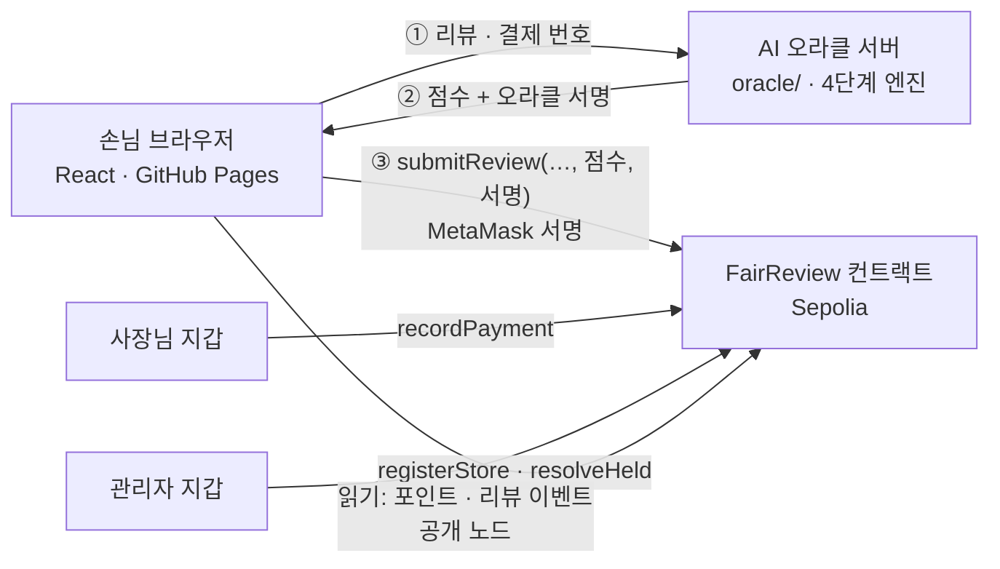

# FairReview

FairReview는 소상공인을 허위 리뷰로부터 보호하고 단골 고객에게 웹3 기반 로열티를 제공하는 탈중앙화 애플리케이션(dApp)입니다. 실제로 결제한 손님만 리뷰를 작성할 수 있으며, 작성된 리뷰는 AI가 신뢰도 점수를 판정하고 그 결과에 대한 서명을 스마트 컨트랙트가 온체인에서 검증해 조작을 막습니다. 검증된 리뷰를 남기고 꾸준히 방문하는 단골에게는 다른 사람에게 양도할 수 없는 포인트를 지급해, 포인트 거래나 리뷰 매수 없이 진짜 고객 관계만이 보상받는 구조를 만듭니다.

건양대학교 스마트보안학과 「Web3.0 개념과 개발」 프로젝트 #36 · Sepolia 테스트넷 전용 (메인넷 · 실제 자산 없음)

| | |
|---|---|
| 화면 (GitHub Pages) | https://whd5753-sudo.github.io/fairreview-dapp/ |
| 컨트랙트 (Sepolia, v2) | [`0x8773d97845c5a58EfDDD8Dde9499Cde4E4eeED0D`](https://sepolia.etherscan.io/address/0x8773d97845c5a58EfDDD8Dde9499Cde4E4eeED0D) |
| AI 오라클 주소 | `0x37eefe78D2e742208bfe1a1f688B2b385D7E5A28` (서명만 하는 테스트 지갑) |

## 한눈에

- **결제한 손님만 리뷰** — 사장님이 결제를 기록한 손님 지갑만, 결제 한 건에 한 번, 30일 안에 쓸 수 있다
- **AI 판정을 컨트랙트가 믿게** — 체인 밖 AI 오라클이 점수에 서명하고, 컨트랙트는 서명을 확인한다. 400 미만 게시 · 400~699 보류(관리자 검토) · 700 이상 거부
- **넘길 수 없는 포인트** — 결제 1% + 리뷰 10포인트. 보내기 함수가 없어 사고팔 수 없고, 리뷰 보상은 별점과 상관없이 같다

## 구조



리뷰 한 건이 컨트랙트에서 통과하는 관문: ① 결제 기록 ② 손님 본인 ③ 처음 쓰는 결제 ④ 30일 이내 ⑤ 별점 · 내용 · 점수 범위 ⑥ **오라클 서명** ⑦ 점수 700 미만

## 폴더

| 폴더 | 내용 | 테스트 |
|---|---|---|
| `web/` | React 19 + Vite · 라우팅 · 지갑 Context · AI 엔진(`src/ai/engine.js`) · 체인 연결(`src/contracts/`) | Vitest **50** (기대값 표 · 화면 · 체인 mock) |
| `contracts/` | Solidity 0.8.24 `FairReview.sol` · Hardhat 2 · OpenZeppelin ECDSA | Hardhat **39** · 뮤테이션 **16/16** |
| `oracle/` | AI 오라클 서버 (`POST /sign`) · 키 생성 · 서명 형식 | node:test **4** |
| `docs/` | 단계별 설계 문서 (정답지) · 보안 점검 · Slither 보고서 | — |
| `.claude/` | Claude Code 하네스: 규칙 · 스킬 · 보안 검토 서브에이전트 · 권한 · 검사 훅 | 훅이 매 수정마다 전체 테스트 |
| `.github/workflows/` | CI (check · web · contracts · oracle) · Pages 배포 (테스트 통과해야 배포) | — |

## 실행

```bash
# AI 오라클 (리뷰 제출에 필요)
cd oracle && npm install && npm test
npm run keygen          # oracle/.env 생성 (처음 한 번, 개인키는 화면에 안 나옴)
npm start               # http://localhost:8787 — ORACLE_CONTRACT 를 .env 에 적은 뒤

# 컨트랙트 (oracle 설치 뒤)
cd contracts && npm install && npx hardhat test && npm run mutation

# 화면
cd web && npm install && npm test && npm run dev   # http://localhost:5173/fairreview-dapp/
```

## 검증

| 항목 | 결과 | 자세히 |
|---|---|---|
| 테스트 | web 50 · contracts 39 · oracle 4, CI 4개 작업 | [테스트설계](docs/테스트설계.md) · [기대값표](docs/기대값표.md) |
| 뮤테이션 | 안전 검사 16줄을 하나씩 지워도 **16/16** 테스트가 잡음 | [보안점검 4절](docs/보안점검.md) |
| 정적 분석 | Slither 3건 (모두 의도된 것, 설명 있음) | [slither-report-10](docs/slither-report-10.txt) |
| 실제 체인 | Sepolia 배포 · 가게 3 · 결제 2 · 리뷰 제출 · 배포된 컨트랙트의 서명 해시 = 오라클 서명 해시 | [오라클설계 9절](docs/오라클설계.md) |

## 보안 · 한계

- 개인키(오라클 · 지갑)는 저장소에 없다: `.gitignore` · `.claude/settings.json` deny · CI 의 `.env` 검사. 배포 · 결제 · 리뷰 서명은 MetaMask (사람이 승인)
- 위협 목록과 대응: [docs/보안점검.md 6절](docs/보안점검.md) — 사장님의 가짜 결제(T2)는 카드사 · PG 연동 없이는 막을 수 없다
- 오라클은 판정을 **위조 못 하게** 할 뿐 **정확하게** 만들지는 않는다 (AI 엔진의 오탐 그대로). 오라클 서버는 사용자 PC 에서 돈다
- 블록체인 기록은 공개 · 영구 (화면에 개인정보 금지 안내)

## 진행 단계 (수업 주차와 함께)

| 단계 | 내용 | 문서 |
|---|---|---|
| 1~3 | 개발 환경 · Claude Code 하네스 · GitHub Actions CI · Pages | `CLAUDE.md`, `.claude/` |
| 4 | AI 문장 판정 엔진 + 기대값 표 + Vitest | [기대값표](docs/기대값표.md) |
| 5 | React 화면 · 테스트 통과해야 배포 | [화면설계](docs/화면설계.md) |
| 6 | SPA 라우팅 · 지갑 Context · 404 대책 | [라우팅설계](docs/라우팅설계.md) |
| 7 | Solidity 컨트랙트 · Remix · Hardhat | [컨트랙트설계](docs/컨트랙트설계.md) |
| 8 | Hardhat 테스트 · Sepolia 배포 · 화면 연결 | [테스트설계](docs/테스트설계.md) · [화면연결설계](docs/화면연결설계.md) |
| 9 | 보안 점검 · 뮤테이션 · Slither | [보안점검](docs/보안점검.md) |
| 10 | AI 오라클 서명 검증 · 보류 리뷰 관리자 검토 | [오라클설계](docs/오라클설계.md) |
| 11 | 정리 · 회고 · 발표 | [회고](docs/회고.md) · [발표준비](docs/발표준비.md) |

## AI 사용

설계 문서(정답지)는 사람이 정하고, Claude Code 가 구현하고, 테스트 · 훅 · CI 가 검증한다. 설명할 수 없는 코드는 넣지 않는다. 단계별로 AI 결과에서 잡아낸 것은 [회고](docs/회고.md)에 적었다.

## 왜 이렇게 설계했나

> ✏️ 아래 세 문장은 2단계 초안이다. 본인 말로 고쳐 쓴다.

1. 개인키가 들어 있는 `.env` 는 한 번 새면 지갑을 통째로 잃기 때문에, Claude 에게 "읽지 마"라고 부탁하는 대신 `.claude/settings.json` 의 deny 규칙으로 읽기·수정 자체를 막았다.
2. Claude 가 "다 했다"고 말해도 실제로 맞는지는 따로 확인해야 하므로 파일을 고칠 때마다 `check.mjs` 가 훅으로 무조건 실행되게 했고, README 에서 FairReview 를 지우자 훅이 바로 잡아냈다. 이때 Claude 가 "검사 규칙을 바꾸자"고 제안했지만, 검사를 약하게 만드는 것은 검증을 없애는 것이라 거절했다.
3. 보안 검토 서브에이전트는 검토만 해야 하므로 Read·Grep·Glob 도구만 줘서, "고치지 마"라고 적는 것보다 확실하게 파일을 고칠 수 없는 구조로 만들었다.
